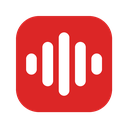
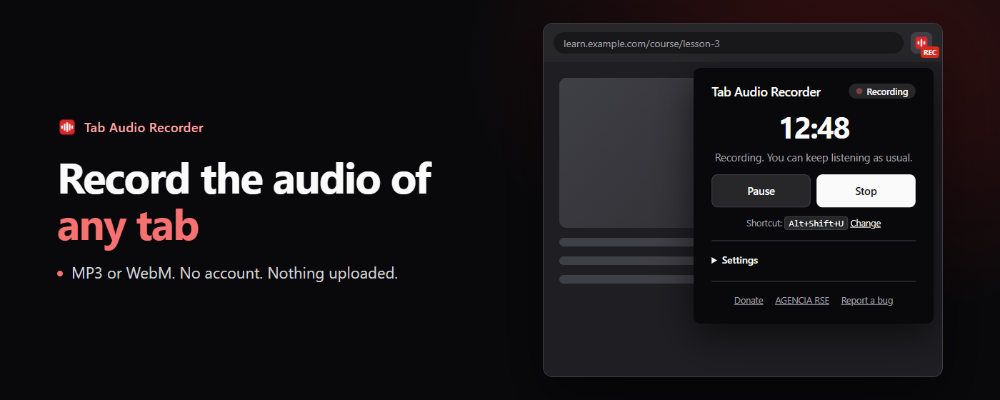
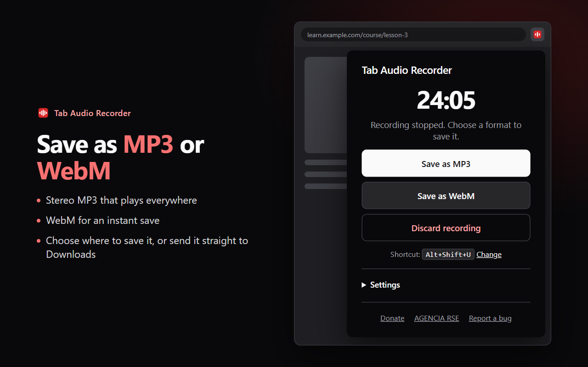
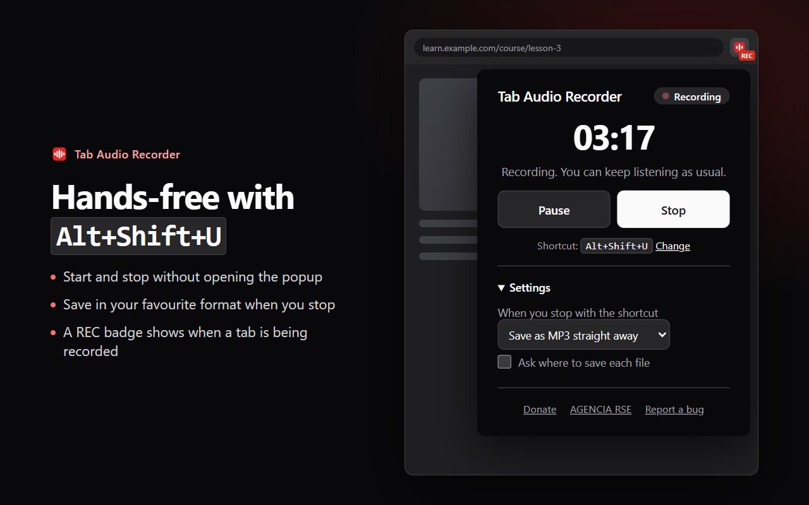

<div align="center">



# Tab Audio Recorder

**Record the audio of any Chrome tab and save it as MP3 or WebM.**
A free Chrome extension that captures only the sound of the tab you choose: no microphone, no notifications, no account, nothing uploaded.

[](https://chromewebstore.google.com/detail/tab-audio-recorder/fhbiepooinheoiehbneophblkkcombfa)
[](manifest.json)
[](LICENSE)



</div>

## ✨ Features

- 🎧 **Only the tab's sound.** It records the tab's audio stream directly, so there is no room noise, no microphone and no system sounds. You keep hearing the tab while it records.
- 💾 **MP3 or WebM.** Stereo MP3 (192 kbps) for any player, or WebM (Opus) for an instant save.
- ⏸️ **Pause and resume.**
- ⌨️ **Keyboard shortcut** <kbd>Alt</kbd>+<kbd>Shift</kbd>+<kbd>U</kbd> (<kbd>Cmd</kbd>+<kbd>Shift</kbd>+<kbd>U</kbd> on macOS) to start and stop. Optionally, save straight away in your favourite format when you stop.
- 🔴 **REC badge** on the toolbar icon while a tab is being recorded.
- 📁 **Ask where to save**, or send every file straight to your Downloads folder.
- 🌍 English and Spanish.
- 🔒 **Private.** No account, no analytics, no network requests. See [PRIVACY.md](PRIVACY.md).

<table>
  <tr>
    <td width="50%"></td>
    <td width="50%"></td>
  </tr>
</table>

## 🚀 How to use it

1. Open the tab with the audio you want: a course, a webinar, a video.
2. Click the extension icon and **Record this tab**, or press <kbd>Alt</kbd>+<kbd>Shift</kbd>+<kbd>U</kbd>.
3. Pause if you need to. Stop with the same button or shortcut.
4. Choose **Save as MP3** or **Save as WebM**. Or, in Settings, choose to save automatically when you stop with the shortcut.

Change the shortcut in `chrome://extensions/shortcuts`. Chrome does not allow recording its own pages (settings, the Web Store, new tab).

## 🛠️ Run from source

1. Open `chrome://extensions` and turn on **Developer mode**.
2. Click **Load unpacked** and pick this folder.

Build the Chrome Web Store package (validates the manifest, locales and files):

```sh
python tools/build-zip.py
```

Store graphics are rendered from `store-assets/src/` with `sh store-assets/src/render.sh`.

## 🧩 How it works

- `background.js`: service worker. Keeps the state (`idle → recording ⇄ paused → finished → saving`), the badge, the shortcut and the downloads.
- `offscreen.js`: offscreen document that holds the tab stream and the `MediaRecorder`, and converts to MP3 with lamejs. Service workers cannot use `getUserMedia`.
- `popup.html` / `popup.js`: the window. It only renders the state stored in `chrome.storage.local`.

## 📄 License

MIT, see [LICENSE](LICENSE). `lame.min.js` is LGPL-3.0, see [THIRD_PARTY_NOTICES.md](THIRD_PARTY_NOTICES.md).

Made by [AGENCIA RSE](https://agenciarse.com).
